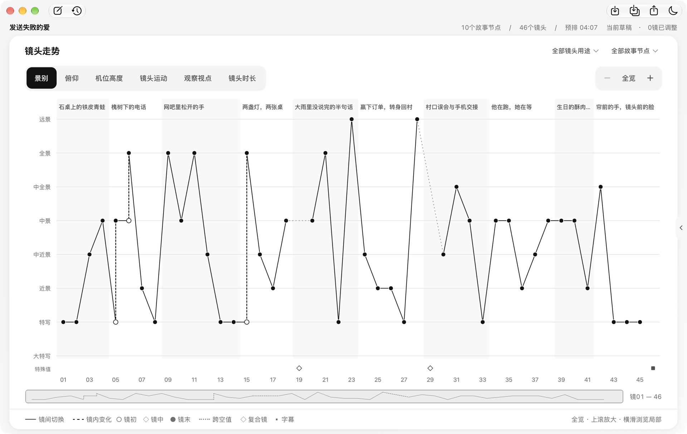
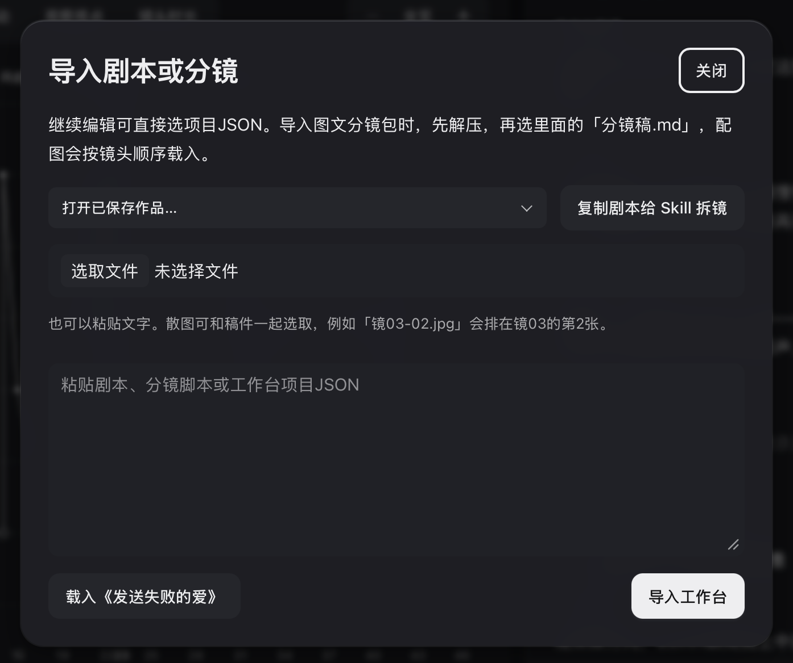
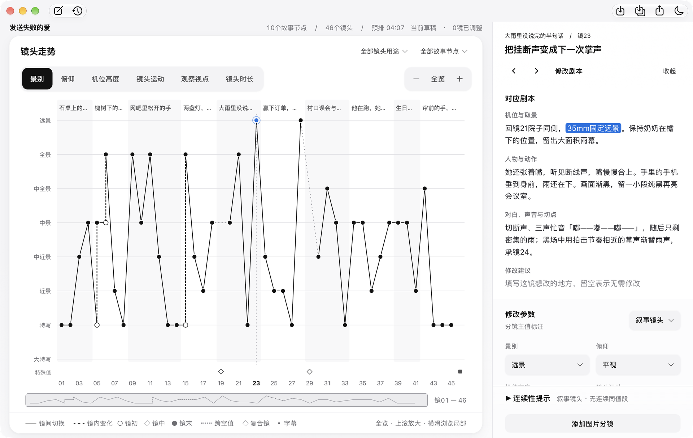
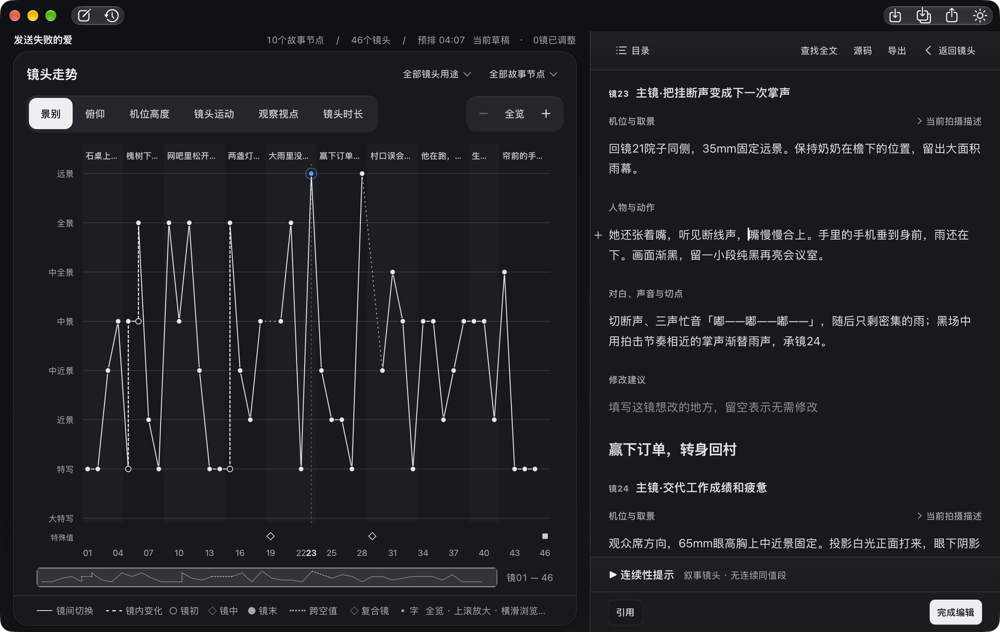
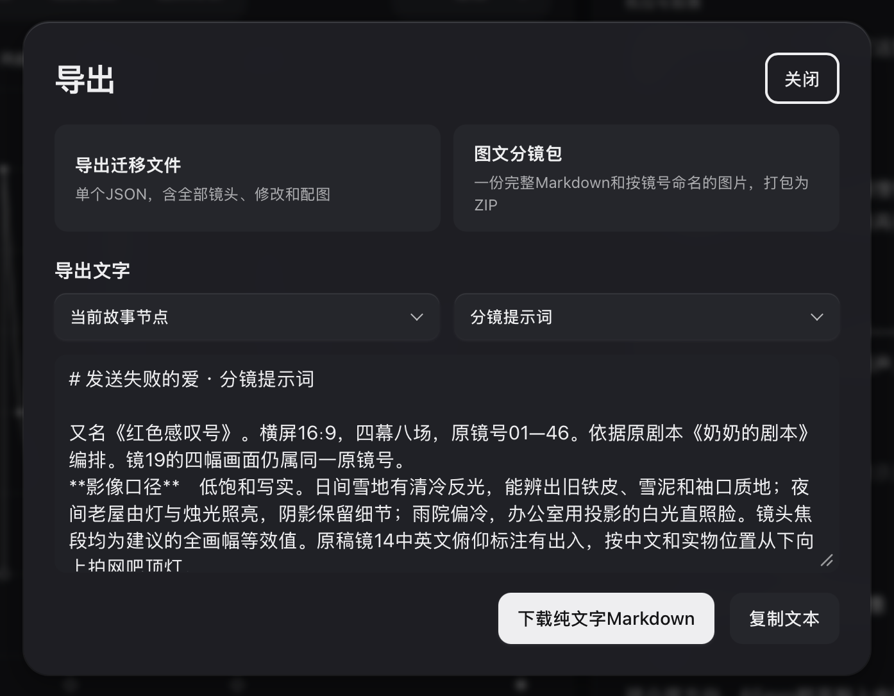

# 子牧曲镜工作台

子牧曲镜工作台是一款离线使用的macOS分镜编辑器。把分镜稿导入后，可以沿着曲线看全片的景别和机位变化，再点进某一镜，对照剧本改参数、写建议、加分镜图。



[下载Mac版（Apple芯片）](https://github.com/zimu0115/storyboard-curve-workbench/releases/download/v1.0/storyboard-curve-workbench-1.0-macOS-arm64.zip) · [查看1.0版更新说明](CHANGELOG.md)

## 第一次使用

解压下载的ZIP，将「子牧曲镜工作台」拖入「应用程序」。安装包适用于Apple芯片和macOS 13及以上版本，采用本地临时签名，未经Apple公证。Intel芯片的Mac可以从源码构建。

首次打开就能看到上图的示例《发送失败的爱》第一版。可以直接在示例上试改，也可以按下面的步骤导入并修改自己的稿件。

### 1. 导入自己的分镜稿

点击窗口右上方的 **「导入稿件」**，选择Markdown或TXT，也可以直接粘贴文字，再点「导入工作台」。已有镜号的分镜稿会按镜头拆开。换电脑接着工作时，在同一窗口选择工作台导出的JSON。



### 2. 在曲线上找出想改的镜头

以顶部总览图为例。横轴从左到右是镜号，分组标题是故事节点。选「景别」时，曲线越高，画面越远。切换到「俯仰」「机位高度」「镜头运动」「观察视点」或「镜头时长」，可以从另一个角度检查同一段戏。

- **看整场戏**。用右上方的故事节点筛选缩小范围。分析对话戏时，可以单独筛选「对话正反打」，查看同一景别来回切换的段落。
- **看一个镜头内部**。同一镜号上的空心圆、菱形和实心圆分别表示镜初、镜中和镜末。滚轮可缩放，触控板横滑或按住Shift滚动鼠标滚轮可左右浏览。
- **查点位对应的台词或动作**。点一下曲线上的圆点，右侧就会展开该镜的剧本和参数。下图选中了第23镜，正文里对应「景别」的文字会以蓝色高亮。



### 3. 改参数、写剧本、加配图

想把某一镜从远景改为中景，可以上下拖动「景别」曲线上的点，也可以在右栏的「修改参数」里选「中景」。需要调整台词或动作时，直接点「对应剧本」里的文字。只想给下一轮改稿留意见，就写在这一镜的「修改建议」里。

点右栏的 **「修改剧本」** 会从当前镜头进入完整文稿。下图是深色模式下的编辑界面，可以边看第23镜的内容，边对照左侧曲线，通过「目录」跳到其他镜头。修改会自动保存，可从顶部「剧本历史」切换作品。



**给镜头配图**。选好镜头后，在右栏底部点「添加图片分镜」，可选择本地图片、粘贴或拖入，每镜最多4张。把鼠标移到曲线点上可预览首张，点击右栏图片可放大，用左右方向键切换同一镜的图片。

### 4. 导出给自己或协作者

点击顶部 **「导出」**，按接收方需要选择格式。

| 想做什么 | 在导出窗口选什么 | 得到什么 |
| --- | --- | --- |
| 换一台Mac继续改曲线和剧本 | 导出迁移文件 | 一个JSON，包含整份剧本、参数、建议和配图。另一台工作台直接导入即可。 |
| 发给协作者或其他AI看图改稿 | 图文分镜包 | 一个ZIP，内含完整Markdown和按镜号排列的配图。解压后选「分镜稿.md」可重新导入，请保持文稿与图片文件夹的相对位置。 |
| 只发文字或提示词 | 导出文字 | 可下载Markdown或复制文本。分镜提示词可选当前故事节点、已修改镜头或全片。 |



## 自带配图的稿件怎么写

在对应镜头下写Markdown图片链接，例如 ``。没有写链接时，可以把稿件和散图一起选取，用 `镜03-01.jpg`、`镜03-02.png` 表示第3镜的第1、2张图。如果不同场次重复使用同一个镜号，请在稿件里写明各自的图片路径。导出的配图为最长边1200像素以内的预览图，高清原图请另存。可编辑文稿支持Markdown和TXT，PDF不支持直接导入。

下面的例子会生成一个5秒镜头，景别从全景推近到中景。

```markdown
# 我的短片

## 01 走到门口

### 镜01（5秒）｜跟进门口

**机位与取景**　35mm平视，跟拍，从全景推近到中景。

镜内景别：全景→中景

**人物与动作**　人物走过门廊，在门边停下。

**对白、声音与切点**　脚步停住，门后传来一声轻响。
```

[查看内置示例《发送失败的爱》第一版](示例/发送失败的爱·第一版.md)

## 构建与运行

需要 macOS 13 或更新版本、Xcode Command Line Tools、Python 3 和 Node.js。在项目根目录运行：

```sh
bash MacApp/build.sh
open "子牧曲镜工作台.app"
```

脚本会为本机架构构建应用并进行临时签名。应用可离线运行。源码版将草稿保存在 `~/Library/Application Support/分镜曲线工作台开源版/`。

## 许可证

工作台原创代码采用 [MIT 许可证](LICENSE)。内置示例剧本及个人品牌标识的权利由各自权利人保留。示例剧本供工作台演示和阅读。第三方代码和资源沿用各自的许可证，见[第三方声明](THIRD_PARTY_NOTICES.md)。
